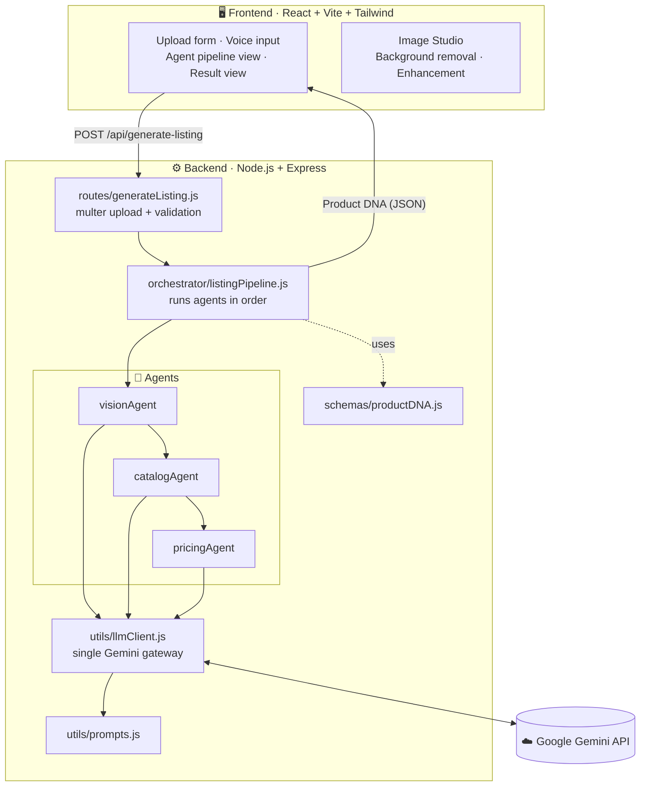
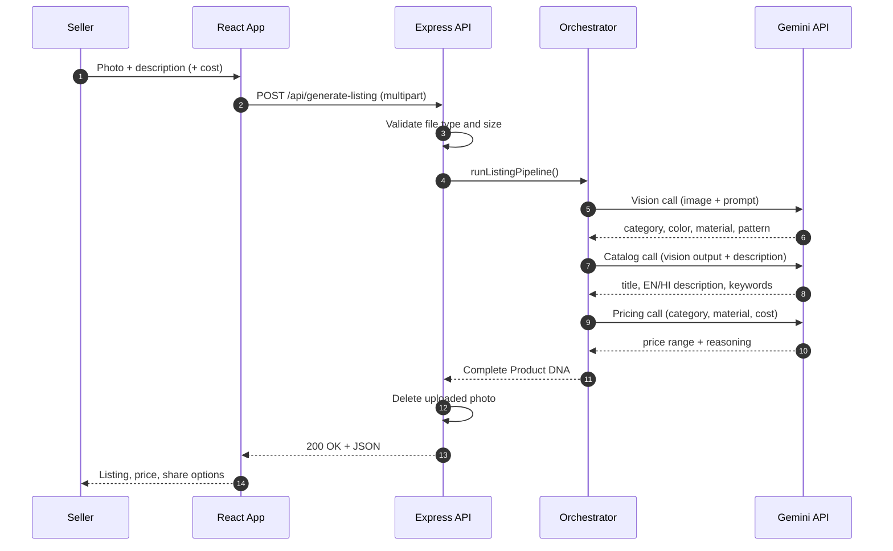

<div align="center">

# ✦ AnushthanAI

### Photo in. Professional listing out.

An agentic AI platform that turns a **product photo + a few words** (typed or spoken in Hindi, English or Hinglish) into a **market-ready, bilingual listing with an AI-suggested price**, built for small sellers, artisans and home-based businesses.

<br/>


[**Demo**](#-demo) · [**Features**](#-features) · [**Architecture**](#-architecture) · [**Getting Started**](#-getting-started) · [**API**](#-api-reference) · [**Roadmap**](#-roadmap)

</div>

---

## 📑 Table of Contents

- [The Problem](#-the-problem)
- [The Solution](#-the-solution)
- [Demo](#-demo)
- [Features](#-features)
- [How It Works](#-how-it-works)
- [Architecture](#-architecture)
- [Tech Stack](#-tech-stack)
- [Project Structure](#-project-structure)
- [Getting Started](#-getting-started)
- [API Reference](#-api-reference)
- [Design Decisions](#-design-decisions)
- [Limitations & Roadmap](#-limitations--roadmap)
- [Author](#-author)

---

## 🎯 The Problem

India has a huge base of micro-entrepreneurs: home cooks, weavers, tailors, jewellery makers, boutique owners. They have good products, but selling online needs several skills at once:

| Barrier | What it looks like |
|---|---|
| 📸 **Presentation** | A cluttered phone photo does not look trustworthy |
| ✍️ **Copywriting** | Writing a title, description and search keywords is hard |
| 💰 **Pricing** | No market knowledge or margin calculation |
| 🗣️ **Language** | Most tools assume typing in English, while many sellers think and speak in Hindi/Hinglish |

The gap is not a missing marketplace. It is the missing help between *having a product* and *having a sellable listing*.

## 💡 The Solution

AnushthanAI takes minimal input and returns a complete listing. Instead of one giant prompt, the work is split across **specialised AI agents** coordinated by an orchestrator. Each agent has one job and one focused prompt, so results are more reliable and easier to debug.

> **Upload a photo → describe it in your own words → get a bilingual listing, a suggested price, and a cleaned-up product image.**

---

## 🎬 Demo

> 📌 *Add your screenshots / GIF / video link here.*

| Create Listing | Agent Pipeline | Result |
|:---:|:---:|:---:|
|  |  |  |

🎥 **Demo video:** `https://your-video-link`

<details>
<summary><b>💡 Try it in 30 seconds</b></summary>

1. Click one of the **Quick demo** chips (Thali, Kurti, Jewellery), or upload your own product photo
2. Describe it by typing, or tap **Speak instead** and talk in Hindi, English or Hinglish
3. Optionally enter your production cost
4. Click **Generate Market Listing** and watch the three agents run
5. Switch between **English / हिन्दी**, then copy or share the result

</details>

---

## ✨ Features

### 🤖 Core AI pipeline
- **Vision Agent** reads the photo and extracts category, colour, material, pattern and a visual description
- **Catalog Agent** writes an SEO-friendly title, English and Hindi descriptions, and search keywords
- **Pricing Agent** suggests a price range in ₹ with the reasoning behind it
- **Product DNA**, a single shared data object that flows through every agent

### 🎙️ Speech input (Hindi · English · Hinglish)
- Speak the product description instead of typing
- Built on the browser's **Web Speech API**, so there is no extra backend or cost
- Typing always works as a fallback

### 🖼️ AI Image Studio
- Upload or capture a product photo
- **Background removal** and **lighting enhancement** to get a clean, e-commerce-style product image
- Side-by-side **Original vs AI Enhanced** view, with download and share

### 🎨 Product experience
- Live **Agent Pipeline** view: waiting → running → completed → error
- **"Detected from your photo"** card with the Vision Agent's confidence value
- Prominent **English / हिन्दी** toggle on the generated listing
- **Copy listing** and **Share with photo** (device share sheet, WhatsApp fallback)
- **AI SYSTEM ONLINE** indicator driven by a real `/api/health` check
- Quick-demo chips, multi-photo upload with a primary photo, and a celebratory confetti burst

---

## 🔄 How It Works


The agents run **one after another inside a single request**. Each one hands structured data to the next.

| Step | Agent | Input | Output (Product DNA fields) |
|---|---|---|---|
| 1 | **Vision** | Product photo | `category`, `color`, `material`, `pattern`, `visualNotes`, `visionConfidence` |
| 2 | **Catalog** | Vision output + seller's description | `title`, `descriptionEn`, `descriptionHi`, `keywords[]` |
| 3 | **Pricing** | Category, material, optional production cost | `priceRange {min, max}`, `priceReasoning` |

---

## 🏗️ Architecture

### System overview



### Request lifecycle



### Error handling policy

| Failure at | Behaviour | Why |
|---|---|---|
| **Vision** | Pipeline stops, UI marks Vision as failed | Nothing meaningful can be generated without it |
| **Catalog** | Pipeline stops, UI marks Catalog as failed | There is no listing to show |
| **Pricing** | Pipeline **continues**, listing returned without a price | A listing without a price is still useful |

---

## 🧰 Tech Stack

| Layer | Technology | Role |
|---|---|---|
| **Frontend** | React (Vite), Tailwind CSS v4, lucide-react, axios | UI, agent pipeline view, result display |
| **Backend** | Node.js, Express 5, multer, cors, dotenv (ES modules) | Uploads, validation, orchestration, API |
| **AI** | Google Gemini API (`@google/generative-ai`) | Vision understanding, text generation, price reasoning |
| **Browser APIs** | Web Speech API, Web Share API, Clipboard API | Voice input, share with photo, copy |
| **Image Studio** | Client-side background removal and canvas enhancement | Product photo clean-up with no API cost |

---

## 📁 Project Structure

```text
AnushthanAI/
├── client/                         # React frontend
│   ├── public/demo-images/         # Sample photos for quick-demo chips
│   └── src/
│       ├── api/                    # API wrapper (axios)
│       ├── components/             # Upload, voice, pipeline, listing, price, image studio
│       ├── pages/                  # Home (input) and Result
│       ├── App.jsx
│       └── index.css
│
├── server/                         # Node.js backend
│   ├── index.js                    # Express entry point
│   ├── routes/generateListing.js   # HTTP layer: upload + validation
│   ├── orchestrator/
│   │   └── listingPipeline.js      # Runs agents in order, merges results
│   ├── agents/
│   │   ├── visionAgent.js
│   │   ├── catalogAgent.js
│   │   └── pricingAgent.js
│   ├── schemas/productDNA.js       # Shared data contract + validators
│   ├── utils/
│   │   ├── llmClient.js            # The only file that calls Gemini
│   │   └── prompts.js              # All prompt templates
│   └── uploads/                    # Temporary upload folder (auto-cleaned)
│
├── data/demo-products/             # Demo assets
├── docs/                           # Screenshots, architecture notes
└── README.md
```

---

## 🚀 Getting Started

### Prerequisites

- **Node.js** 18 or newer
- A free **Gemini API key** from [Google AI Studio](https://aistudio.google.com/apikey)

### 1. Clone

```bash
git clone https://github.com/YOUR_USERNAME/AnushthanAI.git
cd AnushthanAI
```

### 2. Backend

```bash
cd server
npm install
```

Create `server/.env`:

```env
GEMINI_API_KEY=your_api_key_here
GEMINI_MODEL=gemini-3.6-flash
PORT=5000
```

```bash
npm run dev
```

You should see `AnushthanAI server running at http://localhost:5000`.

### 3. Frontend

Open a second terminal:

```bash
cd client
npm install
npm run dev
```

Open the URL Vite prints (usually `http://localhost:5173`).

### Environment variables

| Variable | Required | Description |
|---|:---:|---|
| `GEMINI_API_KEY` | ✅ | Your Gemini API key. It stays on the server and is never exposed to the browser |
| `GEMINI_MODEL` | ➖ | Gemini model to use. Defaults to a fast Flash model |
| `PORT` | ➖ | Backend port (default `5000`) |

> ⚠️ **Heads-up:** Gemini model names change often. If you get a `404 model not found` error, list the models your key can access and update `GEMINI_MODEL`. One listing makes **3 Gemini calls**, so free-tier daily quotas run out quickly during testing.

---

## 📡 API Reference

<details>
<summary><b>POST</b> <code>/api/generate-listing</code></summary>

Generates a complete listing from a photo and description.

**Request** · `multipart/form-data`

| Field | Type | Required | Notes |
|---|---|:---:|---|
| `photo` | file | ✅ | JPEG, PNG or WEBP, max 10 MB |
| `rawDescription` | string | ✅ | Seller's own description (Hindi, English or Hinglish) |
| `sellerCost` | number | ➖ | Production cost in ₹, improves pricing |

**Example**

```bash
curl -X POST http://localhost:5000/api/generate-listing \
  -F "photo=@thali.jpg" \
  -F "rawDescription=Meri maa ke haath ka bana khana, ghar jaisa swaad" \
  -F "sellerCost=60"
```

**Response** · `200 OK`

```json
{
  "category": "homemade vegetarian thali",
  "color": "yellow, green, brown, white",
  "material": "n/a",
  "pattern": "traditional thali plating",
  "visualNotes": "A complete home-cooked meal with dal, chapati, rice and sabzi.",
  "visionConfidence": 0.95,
  "title": "Fresh Homemade Pure Vegetarian Thali",
  "descriptionEn": "...",
  "descriptionHi": "...",
  "keywords": ["homemade veg thali", "ghar ka khana"],
  "priceRange": { "min": 110, "max": 160 },
  "priceReasoning": "...",
  "status": { "vision": "done", "voice": "done", "catalog": "done", "pricing": "done" }
}
```

**Errors:** `400` for a missing photo or description, `500` with `{ "error": "..." }` if an agent step fails (for example `Pipeline stopped at vision step: ...`).

</details>

<details>
<summary><b>GET</b> <code>/api/health</code></summary>

Used by the app's live **AI SYSTEM ONLINE** indicator.

```json
{ "status": "ok", "message": "AnushthanAI backend is running." }
```

</details>

<details>
<summary><b>🧬 Product DNA schema</b></summary>

The single shared object that flows through the pipeline. Each agent reads some fields and writes others.

| Written by | Fields |
|---|---|
| **Vision Agent** | `category`, `color`, `material`, `pattern`, `visualNotes`, `visionConfidence` |
| **Seller input** | `rawDescription`, `sellerCost` |
| **Catalog Agent** | `title`, `descriptionEn`, `descriptionHi`, `keywords` |
| **Pricing Agent** | `priceRange`, `priceReasoning` |
| **Pipeline** | `createdAt`, `status { vision, voice, catalog, pricing }` |

Validators (`validateForCatalog`, `validateForPricing`) check required fields before each agent runs.

</details>

---

## 🧠 Design Decisions

<details>
<summary><b>Why sequential agents and not parallel?</b></summary>

Catalog and Pricing both depend on the Vision output, so Vision must run first. One listing therefore costs 3 Gemini calls in order.

</details>

<details>
<summary><b>Why a Product DNA schema?</b></summary>

One data contract prevents field-name mismatches between agents (for example `colour` vs `color`) and gives the UI a single predictable response shape.

</details>

<details>
<summary><b>Why a separate orchestrator?</b></summary>

Routes stay thin and only handle HTTP. The agent order and the error policy live in one readable file.

</details>

<details>
<summary><b>How is bad model output handled?</b></summary>

Prompts demand JSON only, and a parser strips markdown code fences the model sometimes adds. Required fields are validated between steps, and the price range is checked (numeric, min > 0, max ≥ min) before it is trusted.

</details>

<details>
<summary><b>Why is the model name in <code>.env</code>?</b></summary>

Gemini models are renamed and retired often. Swapping a model is a one-line config change, not a code change.

</details>

<details>
<summary><b>Privacy and security</b></summary>

The API key lives only in the server's `.env`. Uploads are limited to image types and 10 MB, and the uploaded file is deleted right after processing.

</details>

---

## 🧭 Limitations & Roadmap

### Current limitations

- **Pricing is LLM reasoning, not RAG.** It is an estimate from general market knowledge, not retrieved price data.
- **Orchestration is deterministic.** Agents run in a fixed sequence rather than planning for themselves.
- **Agent progress is an approximation.** The backend returns a single response, so the running and completed steps in the UI advance on a timer. The final state, including errors, reflects the real outcome.
- **Speech input** depends on browser support (Chrome and Edge).
- **No login or history yet.** Listings are not stored.

### Roadmap

- [x] Vision, Catalog and Pricing agent pipeline
- [x] Bilingual (English / Hindi) listings
- [x] Speech input in Hindi, English and Hinglish
- [x] AI Image Studio: background removal and lighting enhancement
- [x] Live agent pipeline view and backend health indicator
- [ ] RAG-grounded pricing over a curated price dataset
- [ ] Run Catalog and Pricing in parallel to cut latency
- [ ] Stream real per-agent status (Server-Sent Events)
- [ ] Marketing agent: WhatsApp and Instagram captions
- [ ] Listing history and seller accounts
- [ ] Direct marketplace publishing

---

## 👤 Shambhavi Awasthi

<div align="center">


*Built to help small sellers get online, one photo at a time.*

</div>
